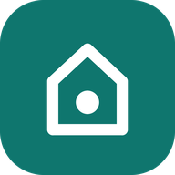
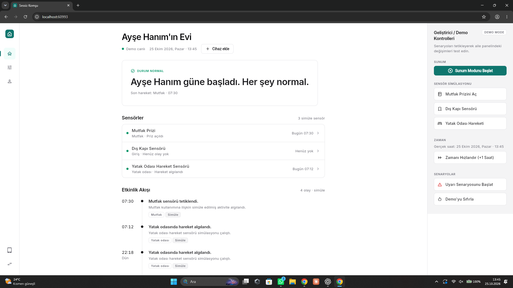
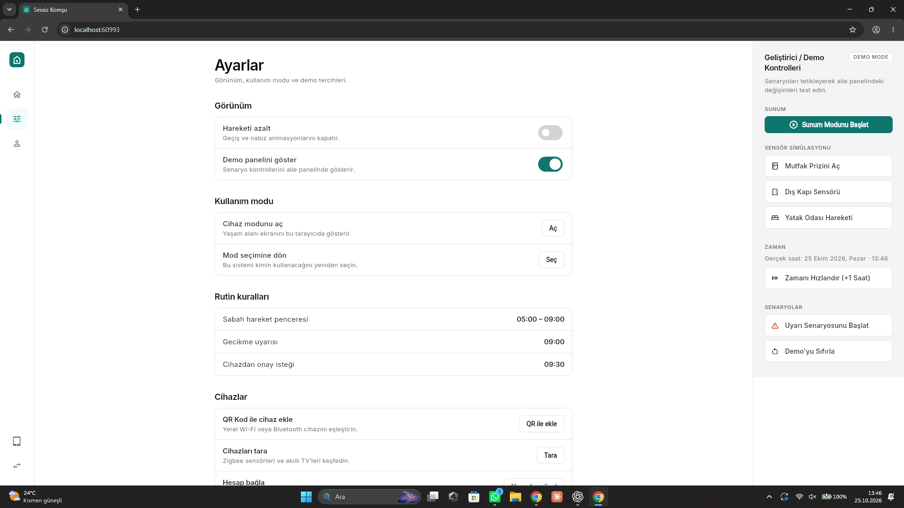
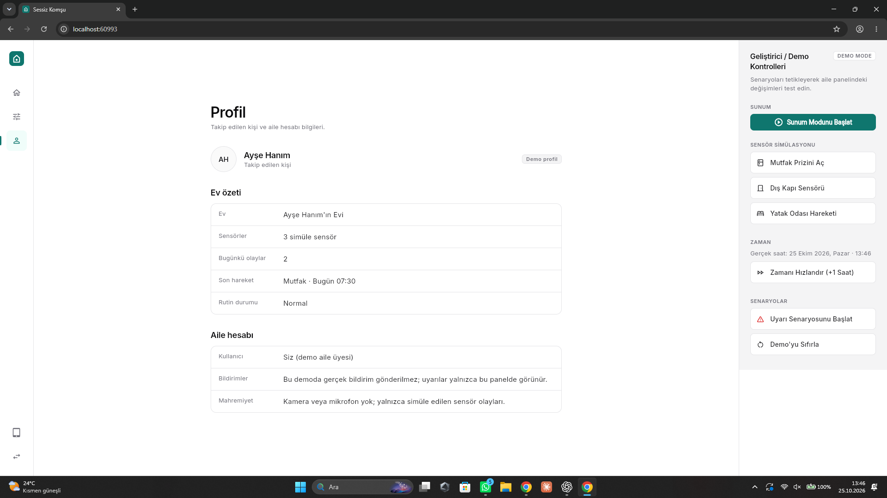
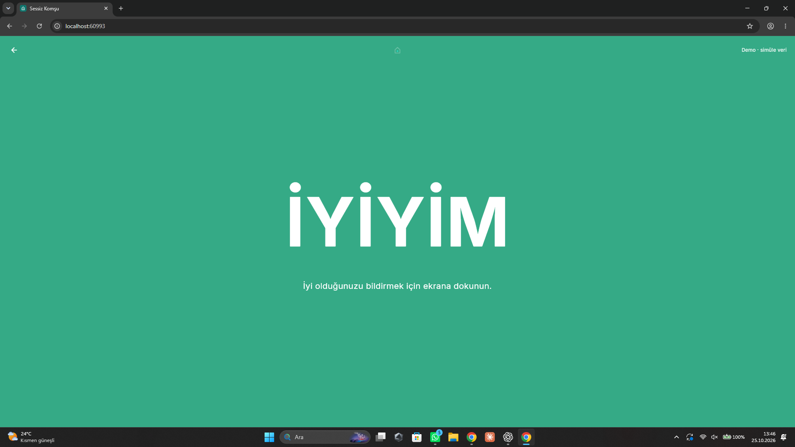
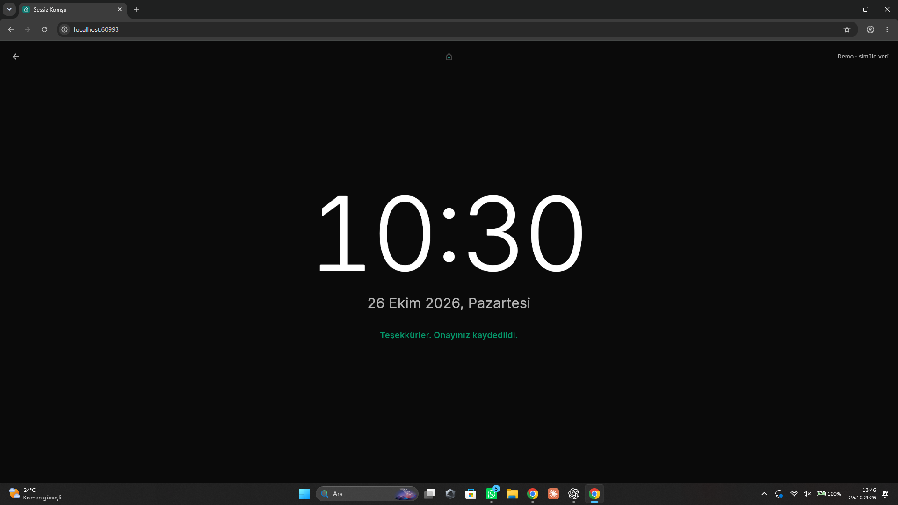
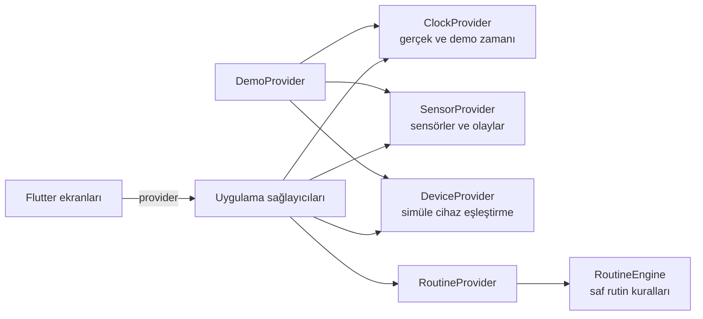

# Sessiz Komşu



**Yaşlı bireylerin günlük rutinini destekleyen, gizliliği önceleyen Flutter Web prototipi.** Aile paneli simüle sensör hareketlerini ve rutin durumunu gösterir; cihaz ekranı ise büyük saat ve gerektiğinde tek dokunuşla **İYİYİM** onayı sunar.

> [!IMPORTANT]
> **Bu uygulama bir demodur.** Gerçek sensör, kamera, mikrofon, konum, bulut hesabı, sunucu veya bildirim bağlantısı yoktur. Veriler tarayıcıda simüle edilir. Uygulama sağlık değerlendirmesi yapmaz; yalnızca rutin zamanlamasını gösterir.

## Özellikler

- **Aile paneli:** rutin durumu, sensörler, olay zaman çizelgesi ve demo kontrolleri.
- **Cihaz modu:** sade siyah ekran, büyük saat ve rutin geciktiğinde **İYİYİM** onayı.
- **Cihaz ekleme demosu:** `SK-XXXX-XXXX` koduyla yerel Wi-Fi/Bluetooth cihazı ekleme, Zigbee sensörü veya akıllı TV tarama, Google Home / Amazon Alexa / Bosch Smart Home / SmartThings hesaplarını simüle bağlama.
- **Sunum modu:** yedi adımlı, uygulamanın gerçek durumunu kullanan rehberli demo.
- **Gizlilik:** kamera, mikrofon veya konum izni istenmez. Gerçek hesap bilgisi toplanmaz.
- **Erişilebilirlik:** klavye kullanımı, görünür odak halkası, anlamlı etiketler ve azaltılmış hareket tercihi.

## Ekran Görüntüleri

### Aile paneli ve cihaz yönetimi

<p align="center">
  
  
</p>

### Profil ve cihaz modu

<p align="center">
  
  
</p>

<p align="center">
  
</p>

## Başlangıç

Gereksinimler: Flutter **3.47.5** stable ve Dart **3.13.4**.

```bash
flutter pub get
flutter run -d chrome
```

Üretim derlemesi:

```bash
flutter build web --release
```

Çıktı `build/web` klasörüne yazılır. Statik sunucu örneği:

```bash
python -m http.server 8080 --directory build/web
```

## Demo akışı

1. **Yakınım İçin — Aile Paneli** veya **Benim İçin — Cihaz Modu** seçin. Seçim tarayıcıda hatırlanır; demo verileri saklanmaz.
2. Aile panelinde sensör satırlarını veya **Cihaz ekle** düğmesini kullanın. QR eşleştirme, cihaz keşfi ve hesap bağlantıları örnek verilerle simüle edilir.
3. Sağdaki **Geliştirici / Demo Kontrolleri** panelinden sensör olayı oluşturun, demo saatini ilerletin veya uyarı senaryosunu başlatın.
4. Cihaz moduna geçerek **İYİYİM** onayının aile panelindeki duruma yansımasını görün.
5. **Demo'yu Sıfırla** olayları, demo saatini, eklenen cihazları ve bağlantı durumlarını temizler. Sunum modu bitince de demo temiz duruma döner.

## Rutin kuralları

Kurallar geçerli demo gününe göre değerlendirilir:

| Durum | Sonuç |
|---|---|
| O gün **İYİYİM** onayı verilmiş | Onaylandı |
| 05.00’ten sonra sensör etkinliği var | Normal |
| Etkinlik yok, saat 09.00’dan önce | Normal; rutin bekleniyor |
| Etkinlik yok, 09.00–09.30 arası | Gecikme uyarısı |
| Etkinlik yok, 09.30’dan sonra | Onay bekleniyor; cihaz ekranında **İYİYİM** gösterilir |

## Mimari



Durum yönetimi `provider` ile yapılır. Rutin mantığı servis katmanındadır; widget’lar karar kurallarını içermez. Olaylar zaman çizelgesinde yeniler üstte olacak şekilde tutulur ve yinelenen olay kimlikleri elenir.

## Proje yapısı

```text
lib/
  core/       tema, ortak metinler, yardımcılar ve küçük bileşenler
  models/     mod, sensör, cihaz, olay ve rutin modelleri
  providers/  uygulama durumu ve demo koordinatörleri
  services/   rutin motoru ve simüle sensör servisi
  screens/    açılış, cihaz, aile paneli ve sunum ekranları
test/
  providers/  sağlayıcı testleri
  widgets/    ekran ve bileşen testleri
  integration/uygulama akışı testi
```

## Bilinen sınırlar

- Sensörler, keşif listesi ve bulut içe aktarımları tamamen simüledir.
- Gerçek cihaz kontrolü, hesap doğrulaması, sunucu, veri tabanı, çağrı, SMS veya push bildirimi yoktur.
- Demo durumu bellekte yaşar; yalnızca seçilen kullanım modu saklanır.
- Tek kişi ve tek ev desteklenir; rutin eşikleri sabittir.
- Arayüz şu an yalnızca Türkçedir.

## Komutlar

```bash
flutter analyze
flutter test
flutter build web --release
```
